# Flow: how the screens link

**Contents:** [The map](#the-map) · [Screens](#screens) · [Gaps](#gaps)

Every route in `src/routes/` (assembled in `src/router.tsx`) and how a person moves between them, plus the screens the spec
names that have no route yet. Read with [plate.md](plate.md), which is the look. The spec is the
product; this map only draws it. `tests/src/flow.test.ts` fails when a route is missing from the
Screens table, isn't its own box in the map or has no arrow touching it, the table lists a path
the router doesn't have, a file it names is gone, or a Status disagrees with its route
(no route, a PageNotBuilt placeholder, or built). It doesn't check where arrows go.

## The map

Solid arrows are links and buttons, labelled with their words. Dashed arrows are the router's
redirects, labelled with the reason. Dotted boxes are screens the spec names that aren't routed.
The menu and top bar sit on every frame page, and on the league pages for someone in a league.

```mermaid
flowchart TD
  classDef planned stroke-dasharray: 2 4
  NOTFOUND(["Any unknown path"]) -.->|"not found"| ROOT
  ROOT["Landing, redirects only<br/>/<br/>everyone"]
  SIGNIN["Sign in<br/>/sign-in<br/>visitor"]
  ROOT -.->|"signed out"| SIGNIN
  ROOT -.->|"in no league"| LEAGUES
  ROOT -.->|"in a league"| TEAM
  SIGNIN -.->|"signed in, with ?join"| JOIN
  SIGNIN -.->|"signed in"| ROOT
  SIGNIN -- "Send the link, then the emailed link" --> ROOT

  subgraph LP["League pages: anyone signed in"]
    LEAGUES["Your leagues<br/>/leagues<br/>manager, commissioner, admin"]
    NEW["Create a league<br/>/leagues/new<br/>admin"]
    MAIL["Mail<br/>/mail<br/>manager, commissioner, admin"]
    INV["Invites and join requests<br/>/leagues/$leagueId/invites<br/>commissioner, admin"]
    JOIN["Join a league<br/>/join/$token<br/>manager, commissioner, admin"]
    GW["Gameweeks<br/>/leagues/$leagueId/gameweeks<br/>commissioner, admin"]
    SQ["Squads<br/>/leagues/$leagueId/squads<br/>commissioner, admin"]
    SC["Player scoring, the rules editor<br/>/leagues/$leagueId/scoring<br/>manager, commissioner; the admin edits"]
    SET["League settings<br/>/leagues/$leagueId/settings<br/>commissioner, admin"]
    ADMIN["Admin dashboard, tab Positions<br/>/admin<br/>admin"]
    FEEDS["Feeds, a tab of the admin dashboard<br/>/admin/feeds<br/>admin"]
    AFB["Feedback, a tab of the admin dashboard<br/>/admin/feedback<br/>admin"]
    FB["Feedback<br/>/feedback<br/>manager, commissioner, admin"]
    PN["Patch notes<br/>/patch-notes<br/>manager, commissioner, admin"]
    CARD["Player card<br/>/leagues/$leagueId/players/$playerCode<br/>manager, commissioner"]
  end
  LP -.->|"signed out (an invite link keeps ?join)"| SIGNIN
  NEW & ADMIN & FEEDS & AFB -.->|"not the admin"| LEAGUES
  GW & SQ & SET & INV -.->|"doesn't run it, or it's being deleted"| LEAGUES
  SC & CARD -.->|"not in it, or it's being deleted"| LEAGUES
  LEAGUES -- "Create a league" --> NEW
  LEAGUES -- "Admin dashboard" --> ADMIN
  ADMIN -- "Feeds" --> FEEDS
  FEEDS -- "Positions" --> ADMIN
  ADMIN & FEEDS -- "Feedback (tab)" --> AFB
  AFB -- "Positions / Feeds" --> ADMIN & FEEDS
  LEAGUES -- "Gameweeks" --> GW
  LEAGUES -- "Invites and join requests" --> INV
  LEAGUES -- "Squads" --> SQ
  LEAGUES -- "Player scoring" --> SC
  SC -- "Patch notes" --> PN
  LEAGUES -- "League settings" --> SET
  NEW -- "Create the league / Back to your leagues" --> LEAGUES
  GW & SQ & SC & SET & ADMIN & FEEDS & AFB & INV -- "Back to your leagues" --> LEAGUES
  JOIN -- "Your leagues" --> LEAGUES
  INV -- "the invite link, sent outside the app" --> JOIN

  subgraph FR["League frame: signed in and in a league"]
    HOME["Home<br/>/home<br/>manager"]
    TEAM["My team, tab Tactics<br/>/team<br/>manager"]
    TSQ["Squad<br/>/team/squad<br/>manager"]
    TFX["Fixtures<br/>/team/fixtures<br/>manager"]
    TTR["Transactions<br/>/team/transactions<br/>manager"]
    MATCHUP["Matchup<br/>/matchup<br/>manager"]
    TABLE["Table and fixtures<br/>/table<br/>manager"]
    SCOUTING["Scouting<br/>/scouting<br/>manager"]
    TRADES["Trades<br/>/trades<br/>manager"]
    PL["Premier League<br/>/premier-league<br/>manager"]
    MATCH["Match<br/>/premier-league/match/$fixtureCode<br/>manager"]
  end
  FR -.->|"signed out"| SIGNIN
  FR -.->|"in no league"| LEAGUES
  TEAM -- "Squad / Fixtures / Transactions" --> TSQ & TFX & TTR
  TEAM -- "a player's name" --> CARD

  MENU(["League frame: top menu and top bar"])
  MENU -- "Home" --> HOME
  MENU -- "My team" --> TEAM
  MENU -- "Matchup" --> MATCHUP
  MENU -- "Table" --> TABLE
  MENU -- "Scouting" --> SCOUTING
  MENU -- "Trades" --> TRADES
  MENU -- "Premier League" --> PL
  MENU -- "Mail / Continue (unread)" --> MAIL
  MENU -- "All your leagues (switcher)" --> LEAGUES
  NOLEAGUE(["Frame for someone in no league"])
  NOLEAGUE -- "Your leagues" --> LEAGUES
  NOLEAGUE -- "Mail" --> MAIL
  MENU & NOLEAGUE -- "Feedback" --> FB
  MENU & NOLEAGUE -- "Patch notes (the banner, while a patch waits)" --> PN
  MENU & NOLEAGUE -.->|"Sign out, then signed out"| SIGNIN
  ERR(["This page can't be shown: any page that throws"]) -- "Back to your leagues" --> LEAGUES
  ERR -.->|"Sign out, when the league frame itself threw, then signed out"| SIGNIN
  TABLE -- "a fixture's score" --> MATCHUP
  HOME -- "a head-to-head's v" --> MATCHUP
  MATCHUP -- "◄ ► (another gameweek's)" --> MATCHUP
  SCOUTING & SQ -- "a player's name" --> CARD
  CARD -- "Back (to Scouting, opened from a link)" --> SCOUTING
  CARD -.->|"its code isn't a number"| SCOUTING

  subgraph PLAN["Named in the spec, no route yet"]
    DRAFT["Draft room<br/>spec/12:16, spec/04<br/>manager, commissioner"]
    CLUBS["Club pages<br/>spec/18:22<br/>after the mini beta"]
  end
  class DRAFT,CLUBS planned
  MATCHUP -- "a player's status (spec/10, not linked yet)" --> MATCH
  PL -- "a fixture's score or v" --> MATCH
  MATCH -.->|"its code isn't a number"| PL
```

## Screens

Status is the route's state only. A built screen has a route and its own page. A placeholder has
a route that says "This screen isn't built yet". `none` in the Path and File columns means no
route yet. Whether a screen is spec'd or to grill, and its issue, is in [SPEC.md](../../SPEC.md)'s
Features table (feature 12), the one home for screen status.

| Screen | Path | File | Spec | Status |
|---|---|---|---|---|
| Landing (redirects only) | `/` | src/routes/frame.tsx | spec/12 The frame | built |
| Sign in | `/sign-in` | src/sign-in/SignInPage.tsx | spec/02, spec/12 The frame | built |
| Your leagues | `/leagues` | src/leagues/LeaguesPage.tsx | spec/12, spec/13 | built |
| Create a league | `/leagues/new` | src/leagues/NewLeaguePage.tsx | spec/13 Creating a league | built |
| Mail | `/mail` | src/mail/MailPage.tsx | spec/16 | built |
| Invites and join requests | `/leagues/$leagueId/invites` | src/joining/InvitesPage.tsx | spec/13 Joining | built |
| Join a league | `/join/$token` | src/joining/JoinPage.tsx | spec/13 Joining | built |
| Gameweeks | `/leagues/$leagueId/gameweeks` | src/gameweeks/GameweeksPage.tsx | spec/13 Gameweeks | built |
| Squads | `/leagues/$leagueId/squads` | src/squads/SquadsPage.tsx | spec/15 Assigning players | built |
| Player scoring, the rules editor | `/leagues/$leagueId/scoring` | src/scoring/ScoringPage.tsx | spec/14 Who owns it, The rules editor | built |
| League settings | `/leagues/$leagueId/settings` | src/leagueSettings/SettingsPage.tsx | spec/03, spec/09 | built |
| Admin dashboard (Positions) | `/admin` | src/admin/AdminPage.tsx | spec/15 The admin, spec/06 | built |
| Feeds, a tab of the admin dashboard | `/admin/feeds` | src/admin/FeedsPage.tsx | spec/15 The admin | built |
| Feedback, a tab of the admin dashboard | `/admin/feedback` | src/admin/FeedbackTab.tsx | spec/15 The admin | built |
| Feedback | `/feedback` | src/feedback/FeedbackPage.tsx | spec/12 The frame, spec/15 The admin | built |
| Patch notes | `/patch-notes` | src/patches/PatchNotesPage.tsx | spec/14 Changes and corrections | built |
| Table and fixtures | `/table` | src/table/TablePage.tsx | spec/12, spec/09 | built |
| Scouting | `/scouting` | src/scouting/ScoutingPage.tsx | spec/19 The players list, The shortlist | built |
| League home | `/home` | src/home/HomePage.tsx | spec/12 League home | built |
| My team (Tactics) | `/team` | src/myTeam/TacticsPage.tsx | spec/12:11, spec/12:28, spec/05 | built |
| Squad | `/team/squad` | src/myTeam/SquadPage.tsx | spec/12 My team's tabs | built |
| Fixtures | `/team/fixtures` | src/myTeam/FixturesPage.tsx | spec/12 My team's tabs | built |
| Transactions | `/team/transactions` | src/myTeam/TransactionsPage.tsx | spec/12 My team's tabs | built |
| Matchup | `/matchup` | src/matchup/MatchupPage.tsx | spec/10 The matchup, spec/12 | built |
| Trades | `/trades` | src/frame/PageNotBuilt.tsx | spec/12 Trades, spec/08 Trades | placeholder |
| Premier League | `/premier-league` | src/premierLeague/PremierLeaguePage.tsx | spec/18 | built |
| Match | `/premier-league/match/$fixtureCode` | src/premierLeague/MatchPage.tsx | spec/10 The match page | built |
| Player card | `/leagues/$leagueId/players/$playerCode` | src/playerCard/PlayerCardPage.tsx | spec/12 The player card, spec/05, spec/14, spec/19 | built |
| Draft room | none | none | spec/12:16, spec/04 | no route |
| Club pages | none | none | spec/18:22 | no route |

## Gaps

- Your leagues has no link into a league's frame pages: the menu, or `/`, gets there.
- An admin in no league can't open the frame, so `/table` and `/team` send him to Your leagues.
- Continue only ever leads to Mail until lineups and trades are built.
