# Flow: how the screens link

**Contents:** [The map](#the-map) · [Screens](#screens) · [Gaps](#gaps)

Every route in `src/router.tsx` and how a person moves between them, plus the screens the spec
names that have no route yet. Read with [plate.md](plate.md), which is the look. The spec is the
product; this map only draws it. `tests/src/flow.test.ts` fails when a route is missing from the
Screens table, isn't its own box in the map or has no arrow touching it, the table lists a path
the router doesn't have, a file it names is gone, or a Status disagrees with its file
(PageNotBuilt is a placeholder, any other page is built). It doesn't check where arrows go.

## The map

Solid arrows are links and buttons, labelled with their words. Dashed arrows are the router's
redirects, labelled with the reason. Dotted boxes are screens the spec names that aren't routed.
The menu and top bar sit on every frame page, and on the league pages for someone in a league.

```mermaid
flowchart TD
  classDef planned stroke-dasharray: 2 4
  NOTFOUND(["Any unknown path"]) -.->|"not found"| ROOT
  ROOT["Landing, redirects only<br/>/<br/>everyone"]
  SIGNIN["Sign in<br/>/sign-in<br/>visitor"]
  ROOT -.->|"signed out"| SIGNIN
  ROOT -.->|"in no league"| LEAGUES
  ROOT -.->|"in a league"| TEAM
  SIGNIN -.->|"signed in, with ?join"| JOIN
  SIGNIN -.->|"signed in"| ROOT
  SIGNIN -- "Send the link, then the emailed link" --> ROOT

  subgraph LP["League pages: anyone signed in"]
    LEAGUES["Your leagues<br/>/leagues<br/>manager, commissioner, admin"]
    NEW["Create a league<br/>/leagues/new<br/>admin"]
    MAIL["Mail<br/>/mail<br/>manager, commissioner, admin"]
    INV["Invites and join requests<br/>/leagues/$leagueId/invites<br/>commissioner, admin"]
    JOIN["Join a league<br/>/join/$token<br/>manager, commissioner, admin"]
    GW["Gameweeks<br/>/leagues/$leagueId/gameweeks<br/>commissioner, admin"]
    SQ["Squads<br/>/leagues/$leagueId/squads<br/>commissioner, admin"]
    SC["Scoring, the rules editor<br/>/leagues/$leagueId/scoring<br/>commissioner, admin"]
    ADMIN["Admin dashboard, tab Positions<br/>/admin<br/>admin"]
    FEEDS["Feeds, a tab of the admin dashboard<br/>/admin/feeds<br/>admin"]
  end
  LP -.->|"signed out (an invite link keeps ?join)"| SIGNIN
  NEW & ADMIN & FEEDS -.->|"not the admin"| LEAGUES
  GW & SQ & SC & INV -.->|"doesn't run it, or it's being deleted"| LEAGUES
  LEAGUES -- "Create a league" --> NEW
  LEAGUES -- "Admin dashboard" --> ADMIN
  ADMIN -- "Feeds" --> FEEDS
  FEEDS -- "Positions" --> ADMIN
  LEAGUES -- "Gameweeks" --> GW
  LEAGUES -- "Invites and join requests" --> INV
  LEAGUES -- "Squads" --> SQ
  LEAGUES -- "Scoring" --> SC
  NEW -- "Create the league / Back to your leagues" --> LEAGUES
  GW & SQ & SC & ADMIN & FEEDS & INV -- "Back to your leagues" --> LEAGUES
  JOIN -- "Your leagues" --> LEAGUES
  INV -- "the invite link, sent outside the app" --> JOIN

  subgraph FR["League frame: signed in and in a league"]
    HOME["Home<br/>/home<br/>manager"]
    TEAM["My team, tab Tactics<br/>/team<br/>manager"]
    TSQ["Squad<br/>/team/squad<br/>manager"]
    TFX["Fixtures<br/>/team/fixtures<br/>manager"]
    TTR["Transactions<br/>/team/transactions<br/>manager"]
    MATCHUP["Matchup<br/>/matchup<br/>manager"]
    TABLE["Table and fixtures<br/>/table<br/>manager"]
    PLAYERS["Players<br/>/players<br/>manager"]
    TRADES["Trades<br/>/trades<br/>manager"]
    PL["Premier League<br/>/premier-league<br/>manager"]
  end
  FR -.->|"signed out"| SIGNIN
  FR -.->|"in no league"| LEAGUES
  TEAM -- "Squad / Fixtures / Transactions" --> TSQ & TFX & TTR

  MENU(["League frame: top menu and top bar"])
  MENU -- "Home" --> HOME
  MENU -- "My team" --> TEAM
  MENU -- "Matchup" --> MATCHUP
  MENU -- "Table" --> TABLE
  MENU -- "Players" --> PLAYERS
  MENU -- "Trades" --> TRADES
  MENU -- "Premier League" --> PL
  MENU -- "Mail / Continue (unread)" --> MAIL
  MENU -- "All your leagues (switcher)" --> LEAGUES
  NOLEAGUE(["Frame for someone in no league"])
  NOLEAGUE -- "Your leagues" --> LEAGUES
  NOLEAGUE -- "Mail" --> MAIL
  MENU & NOLEAGUE -.->|"Sign out, then signed out"| SIGNIN
  ERR(["This page can't be shown: any page that throws"]) -- "Back to your leagues" --> LEAGUES

  subgraph PLAN["Named in the spec, no route yet"]
    MATCH["Match<br/>spec/10:17<br/>manager"]
    CARD["Player card<br/>spec/12:16<br/>manager"]
    DRAFT["Draft room<br/>spec/12:16, spec/04<br/>manager, commissioner"]
    SETTINGS["League settings<br/>spec/12:16<br/>commissioner"]
    CLUBS["Club pages<br/>spec/18:22<br/>after the mini beta"]
  end
  class MATCH,CARD,DRAFT,SETTINGS,CLUBS planned
  MATCHUP -- "a player's status (spec/10:23)" --> MATCH
  PL -- "each fixture (spec/18:12)" --> MATCH
```

## Screens

A built screen has a route and its own page. A placeholder has a route that says "This screen
isn't built yet". `none` in the Path and File columns means no route yet.

| Screen | Path | File | Spec | Status |
|---|---|---|---|---|
| Landing (redirects only) | `/` | src/router.tsx | spec/12 The frame | built |
| Sign in | `/sign-in` | src/sign-in/SignInPage.tsx | spec/02, spec/12 The frame | built |
| Your leagues | `/leagues` | src/leagues/LeaguesPage.tsx | spec/12, spec/13 | built |
| Create a league | `/leagues/new` | src/leagues/NewLeaguePage.tsx | spec/13 Creating a league | built |
| Mail | `/mail` | src/mail/MailPage.tsx | spec/16 | built |
| Invites and join requests | `/leagues/$leagueId/invites` | src/joining/InvitesPage.tsx | spec/13 Joining | built |
| Join a league | `/join/$token` | src/joining/JoinPage.tsx | spec/13 Joining | built |
| Gameweeks | `/leagues/$leagueId/gameweeks` | src/gameweeks/GameweeksPage.tsx | spec/13 Gameweeks | built |
| Squads | `/leagues/$leagueId/squads` | src/squads/SquadsPage.tsx | spec/15 Assigning players | built |
| Scoring, the rules editor | `/leagues/$leagueId/scoring` | src/scoring/ScoringPage.tsx | spec/14 The rules editor | built |
| Admin dashboard (Positions) | `/admin` | src/admin/AdminPage.tsx | spec/15 The admin, spec/06 | built |
| Feeds, a tab of the admin dashboard | `/admin/feeds` | src/admin/FeedsPage.tsx | spec/15 The admin | built |
| Table and fixtures | `/table` | src/table/TablePage.tsx | spec/12, spec/09 | built |
| League home | `/home` | src/frame/PageNotBuilt.tsx | spec/12:16 | to grill (placeholder) |
| My team (Tactics) | `/team` | src/frame/PageNotBuilt.tsx | spec/12:11, spec/12:28, spec/05 | spec'd (placeholder, #14) |
| Squad | `/team/squad` | src/frame/PageNotBuilt.tsx | tab from mock-up R3·1, not the spec | to grill (placeholder) |
| Fixtures | `/team/fixtures` | src/frame/PageNotBuilt.tsx | tab from mock-up R3·1, not the spec | to grill (placeholder) |
| Transactions | `/team/transactions` | src/frame/PageNotBuilt.tsx | tab from mock-up R3·1, not the spec | to grill (placeholder) |
| Matchup | `/matchup` | src/frame/PageNotBuilt.tsx | spec/10 The matchup | spec'd (placeholder, #34) |
| Players | `/players` | src/frame/PageNotBuilt.tsx | spec/12:16 | to grill (placeholder) |
| Trades | `/trades` | src/frame/PageNotBuilt.tsx | spec/12:16, spec/08 | to grill (placeholder) |
| Premier League | `/premier-league` | src/frame/PageNotBuilt.tsx | spec/18 | spec'd (placeholder, #49) |
| Match | none | none | spec/10 The match page | spec'd (#45) |
| Player card | none | none | spec/12:16, spec/05:59, spec/14 | to grill |
| Draft room | none | none | spec/12:16, spec/04 | spec'd, waits for the summer |
| League settings | none | none | spec/12:16 | to grill |
| Club pages | none | none | spec/18:22 | spec'd, after the mini beta |

## Gaps

- Your leagues has no link into a league's frame pages: the menu, or `/`, gets there.
- An admin in no league can't open the frame, so `/table` and `/team` send him to Your leagues.
- Continue only ever leads to Mail until lineups and trades are built.
